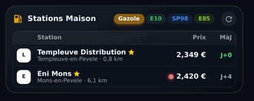

# ⛽ Carburant HOLM

[](https://hacs.xyz/)


[🇫🇷 Français](README.md) · 🇬🇧 English

**Where to fill up at the best price near you, at a glance?**

Carburant HOLM (*carburant* means fuel) is a **Home Assistant** integration that continuously tracks **fuel prices in France** around your home, or around any town. It finds **the cheapest station in your zone**, follows the **price trend**, keeps an eye on **your favourite stations** and provides **a modern Lovelace card**, ready to use.

> ✨ **100 % automatic, 100 % visual, zero YAML.**
> Install it, choose your town and radius **on a map**, tick your stations: that's all.
> The card is added from the card picker and **all its settings are in the visual editor**.

> ℹ️ Data comes from the official French government feed: only **stations in France** are covered.

### At a glance

- 🗺️ **Your zone, drawn on a map**: a town or postcode, then the point and radius adjusted with the mouse (1 to 50 km). As many zones as you like: Home, Work, Holidays…
- 📍 **Mobile zone**: the zone can follow a person or a phone (companion app); nearby stations are reloaded as they move.
- 🧩 **Several zones in one card**: stations combined, ranking and best price computed over all of them.
- 🏆 **The cheapest, right away**: the best station of the zone for each fuel, its price, distance, gap to the average and a **Directions** button.
- 📈 **The trend**: 120-day history, change over 1 and 7 days and a “best price / average” curve in the card.
- ⭐ **Your stations**: price, rank in the zone, gap to the best price and to the average, and history for each one (with its curve in the station's details), favourites included **even outside the zone**: a search by town or postcode lets you add any station in France.
- 🧭 **One tap and off you go**:
  - **compact view**: tapping a station opens **Google Maps in directions mode**;
  - **full view**: tapping a station expands **its details** (address, prices of **all** its fuels, services, 24/7 pay at pump) with **Google Maps** and **Waze** buttons;
  - configurable: directions, details, or **read-only** (no link).
- 🔤 **Stations with the same name told apart**: two “Super U Poitiers” show their address.
- 🏷️ **Names, brands and logos found automatically**, nothing to enter (OpenStreetMap and Wikimedia).
- 🚫 **No stale prices**: a price that is too old (adjustable threshold) no longer counts in the ranking, and each price shows its freshness.
- ⛔ **Shortages flagged**: a station out of stock is clearly shown.
- 🔔 **Ready for your automations**: rich sensors (station, distance, top 5, trends…) to be notified when diesel goes down or when the cheapest station changes.
- 🔄 **Always up to date**: prices are refreshed automatically (from 10 min to 24 h), with a ↻ button to force it, and new versions come through HACS.
- 🌍 **8 languages**: English, French, German, Spanish, Italian, Dutch, Portuguese and Polish (integration and card).

Official data: instant feed v2 of the French Ministry of the Economy ([data.economie.gouv.fr](https://data.economie.gouv.fr/explore/dataset/prix-des-carburants-en-france-flux-instantane-v2/)), updated continuously by the stations.

| Full card | Compact card | Compact · favourites |
|---|---|---|
|  |  |  |

*Screenshots in French — the card follows the language of your Home Assistant profile.*

### 🆕 What's new in 1.6.0

- 🌍 **8 languages**: the integration (setup, options, entities, actions) is translated into English, French, German, Spanish, Italian, Dutch, Portuguese and Polish, following the language of Home Assistant. The **HOLM Fuel** card too, editor included; its `language` option lets you force a language.
- 🇬🇧 English README.

### What's new in 1.5.0

- 📈 **Values on the curve** ([#9](https://github.com/kaaribou/carburant-holm/issues/9)): highest and lowest price of the period on the axis, best price and average of the day at the end of the curves, and a day's details (date, best price, average) on hover or tap. `chart_values` option to go back to the plain curve.
- 🏷️ **A curve per station**: in a station's expanded details, the curve of its price for the chosen fuel, compared with the zone average, with the same values. History is now recorded for all stations in the zone.

### What's new in 1.4.0

| | |
|---|---|
| ⭐ **Favourites outside the zone** | Add **any station in France** to your favourites: in the favourites step, type a town or postcode, tick the stations found. They show with an “outside zone” tag. |
| 🧩 **Several zones in one card** | Combine *Home* and *Work* (or more) in the same card: one ranking, one best price. |
| 📍 **Mobile zone** | The zone follows a person or a phone: nearby stations reload as you travel. |
| ↕️ **Sort of your choice** | Lowest price first (favourites and outside zone mixed), distance, update, name… and one-click sort on the compact view's headers. |
| 👆 **Tap on a station** | Directions, details, or **read-only** with no link. |
| 🔤 **Stations with the same name** | Two “Super U” in the same town? Their address is shown to tell them apart. |

---

## Contents

- [Why this integration?](#why-this-integration)
- [Installation](#installation)
- [Configuration](#configuration)
- [Editing a zone (options)](#editing-a-zone-options)
- [Entities created](#entities-created)
- [The `holm-fuel-card`](#the-holm-fuel-card)
- [Automation examples](#automation-examples)
- [Template examples](#template-examples)
- [WebSocket API](#websocket-api)
- [How are prices computed?](#how-are-prices-computed)
- [FAQ / troubleshooting](#faq--troubleshooting)
- [Credits & licence](#credits--licence)

---

## Why this integration?

| Need | Carburant HOLM |
|---|---|
| **Easy install** | HACS, a restart, then a **step-by-step wizard** in *Settings → Devices & services*. **Not a line of YAML.** |
| **Pick a zone simply** | Type a **town or postcode** and adjust **the point and radius right on a map**. Change them later in two clicks in *Configure*. |
| **Pick stations without looking up IDs** | The wizard **lists all stations in the zone**, sorted by distance, with their name, town and current prices: tick your favourites. |
| **Know where it's cheapest** | A **“Best price”** sensor per fuel: station, brand, address, distance, price date, gap to average and **top 5**. |
| **Follow the trend** | **120-day history** (best price and zone average, price of each station in the zone and of your favourites) and **1- and 7-day trend**, shown in the card and usable in your automations. |
| **Don't get caught by an old price** | Prices older than *N* days (adjustable) are **ignored**; each price shows its freshness (● green, orange or grey, or *D+n*). |
| **A nice display, no setup** | The **`holm-fuel-card`** is **provided, served and registered automatically**: nothing to add to the Lovelace resources. It is in the card picker as **“HOLM Fuel”**. |
| **Everything with the mouse** | **Full visual editor**: zone, layout (full or compact), default fuel, tabs shown, number of stations, curve, favourites… |
| **Two layouts** | **Full**: tabs per fuel, cheapest station highlighted, curve, ranking and details on tap. **Compact**: a clean table (logo, station, price, *D+n*) whose rows open **Google Maps directions**. |
| **Leave right away** | **Directions in one gesture**: Google Maps from the compact view and the main card, **Google Maps or Waze** from a station's details. |
| **Recognisable stations** | **Names, brands and logos** fetched automatically and cached; otherwise clean initials. |
| **Several places** | **As many zones as needed**, each with its sensors, favourites and card. |

Supported fuels: **Diesel (Gazole), E10 (SP95-E10), SP98, SP95, E85, LPG (GPLc)**.

---

## Installation

### Via HACS (recommended)

1. HACS → **⋮** menu → **Custom repositories**.
2. Repository: `https://github.com/kaaribou/carburant-holm` — Type: **Integration** → **Add**.
3. Search for **Carburant HOLM** → **Download**.
4. **Restart** Home Assistant.

New versions then show in **Settings → Updates**.

### Manually

Copy the `custom_components/carburant_holm` folder to `/config/custom_components/`, then restart Home Assistant.

> The `holm-fuel-card` is included: **no Lovelace resource to add**, the integration registers it itself (and updates its version number on each update).

---

## Configuration

**Settings → Devices & services → Add integration → Carburant HOLM.**

| Step | What you do |
|---|---|
| 1. Zone | Give a **name** (e.g. *Home*, *Work*). Leave **Town** empty to centre on your home, type a **town / postcode**, or choose a **person / phone** for a **mobile zone**. |
| 2. Town | If several towns match, choose the right one (search via geo.api.gouv.fr). |
| 3. Map | **Move the point** and **adjust the circle**: all stations within this radius are compared (mobile zone: radius only). Choose the **fuels**, the **maximum age of a price** (default 7 days) and the **refresh interval** (10 min to 24 h, default 30 min). |
| 4. Favourites | Tick your usual stations in the list (name, town, distance and current prices shown). **Station outside the zone**: type a town or postcode in the search box and submit; its stations are added to the list (“outside zone”). |

### Mobile zone

Choose a **person** (`person.*`) or a **device** (`device_tracker.*`, for example the phone with the companion app): the zone is centred on its position and stations are reloaded once it has moved about a third of the radius (at least 1 km, at most once every 2 minutes). At home without GPS, the home position is used. History and the trend curve make no sense for a moving zone: they are not computed.

You can create **as many zones as you like**: each zone is an independent entry with its own sensors.

### Settings

| Setting | Default | Role |
|---|---|---|
| Zone name | *Home* or the town's name | Name of the device and entities (“Carburant Maison”). |
| Centre & radius | Home, 10 km | Comparison zone (1 to 50 km). |
| Tracked fuels | Diesel, E10, SP98, E85 | One set of sensors per fuel. |
| Ignore prices older than | 7 days | A price not updated for longer doesn't enter the best price / average. |
| Refresh | 30 min | How often the API is queried (stations usually publish several times a day). |
| Favourite stations | — | Stations with dedicated sensors and history, even outside the zone. |

---

## Editing a zone (options)

**Settings → Devices & services → Carburant HOLM → Configure**:

1. Rename the zone and/or type a **new town** to re-centre it (empty = keep the current centre), or choose a **person / phone** to make it a **mobile zone** (clear the field to go back to a fixed zone);
2. Adjust the **point / radius** (mobile zone: the radius), the **fuels**, the max age and the refresh;
3. Update the **favourites**; for a **station outside the zone**, type a town or postcode in the search box, submit, tick the stations found and submit again.

The integration reloads automatically.

---

## Entities created

Each zone creates a **“Carburant *Name*”** device and, for each favourite, a **station** device linked to the zone.

### Per fuel (zone)

| Entity | State | Main attributes |
|---|---|---|
| `sensor.carburant_<zone>_meilleur_prix_<fuel>` | Lowest price in the zone (€/L) | `station`, `brand`, `address`, `city`, `distance_km`, `latitude`, `longitude`, `updated`, `average`, `max`, `stations_count`, `trend_1d`, `trend_7d`, `top` (5 cheapest), image = brand logo |
| `sensor.carburant_<zone>_prix_moyen_<fuel>` | Average price in the zone (€/L) | `stations_count`, `max` |

### Per favourite station and per fuel

| Entity | State | Main attributes |
|---|---|---|
| `sensor.<station>_<fuel>` | Pump price (€/L) | `station`, `brand`, `address`, `city`, `distance_km`, `updated`, `days_since_update`, `shortage`, `rank` (rank in the zone), `stations_count`, `delta_vs_best`, `delta_vs_average` |

### Others

| Entity | Role |
|---|---|
| `button.carburant_<zone>_actualiser_les_prix` | Forces an immediate refresh. |

All price values have `state_class: measurement`: they feed Home Assistant's **long-term statistics** (native graphs, *statistics-graph* card, etc.).

> Exact entity_ids depend on the zone and station names (and on the language when they were created); find them in the zone's device.

---

## The `holm-fuel-card`

Add a card → search for **“HOLM Fuel”**. Everything is set in the visual editor; no entity to choose, the card reads the zone data directly.

### Full view

- **Fuel tabs** with the best price of each;
- **Cheapest station**: logo, name, town, distance, price, price age, **7-day trend**, **gap to average**, **Directions** button;
- **Curve** of the zone's best price / average (up to 45 days), with extreme prices, the day's values and a day's details on hover or tap;
- **Ranking** with a relative bar, gap to the first, price freshness (● green < 48 h, ● orange ≤ 3 d, ● grey beyond), shortages;
- **Your favourites** pinned (★) even outside the top, including stations **outside the zone**;
- **Sort of your choice** (*Station sort* option): ranking then favourites, or a single list sorted by price, distance, update or name;
- **Several zones** combined if you choose several (ranking and best price over all); a **mobile zone** shows “around …” and hides the curve;
- **Tap a station**: address, **all its fuels**, services (car wash, shop, air, ATM…), 24/7 pay at pump, **Google Maps** and **Waze** links (or direct directions, or nothing: *Tap on a station* option);
- **↻** refresh button.

### Compact view

A “station list” table: logo · name (town, distance) · price · **Upd. as D+n**, ● green dot on the cheapest and ● red on the most expensive, fuel buttons and **↻**. Tapping a row opens directions (or the details, or nothing: *Tap on a station* option). The *Station* (distance), *Price* and *Upd.* headers can be clicked to sort. *Favourites only* option.

### Options

| Option | YAML | Default | Description |
|---|---|---|---|
| Language | `language` | the profile's | `fr`, `en`, `de`, `es`, `it`, `nl`, `pt`, `pl`. |
| Zones | `entry_ids` | first zone | One or more zones; several zones are combined in the same card (ranking and best price over all). The old `entry_id` is still accepted. |
| Station sort | `sort` | `default` | `default` (ranking then favourites), `price` (lowest first, favourites and outside zone included), `distance`, `updated` (most recent update) or `name`. In the compact view, clicking the *Station* / *Price* / *Upd.* headers also sorts on the fly. |
| Tap on a station | `station_click` | `details` (full) / `maps` (compact) | `details`, `maps` (Google Maps directions) or `none` (read-only, no link). |
| Layout | `layout` | `full` | `full` or `compact`. |
| Appearance | `theme` | `auto` | `auto` (follows Home Assistant's light / dark mode), `dark`, `light` or `theme` (your theme's colours). |
| Title | `title` | “Fuel *zone*” / “Stations *zone*” | Custom title. |
| Default fuel | `fuel` | first tracked | `gazole`, `e10`, `sp98`, `sp95`, `e85`, `gplc`. |
| Tabs | `fuels` | all | List of fuels offered in the card. |
| Rows | `rows` | `6` | Number of stations in the ranking. |
| Curve | `show_chart` | `true` | Shows the trend (full view). |
| Values on the curve | `chart_values` | `true` | Extreme prices, the day's values and a day's details on hover. `false`: curve only. |
| Favourites | `show_favorites` | `true` | Adds your favourites outside the top. |
| Favourites only | `favorites_only` | `false` | Compact view limited to your favourites. |

```yaml
# Full view, diesel by default, 8 stations
type: custom:holm-fuel-card
fuel: gazole
rows: 8

# Compact view limited to my stations, E10 and SP98 tabs
type: custom:holm-fuel-card
layout: compact
favorites_only: true
fuels: [e10, sp98]
title: My stations

# Two zones combined, read-only
type: custom:holm-fuel-card
entry_ids: [abc123, def456]
station_click: none
```

---

## Automation examples

**Alert when diesel drops below a threshold**

```yaml
alias: Cheap diesel
triggers:
  - trigger: numeric_state
    entity_id: sensor.carburant_maison_meilleur_prix_gazole
    below: 1.70
actions:
  - action: notify.mobile_app_my_phone
    data:
      title: "⛽ Diesel at {{ states('sensor.carburant_maison_meilleur_prix_gazole') }} €"
      message: >
        {{ state_attr('sensor.carburant_maison_meilleur_prix_gazole', 'station') }}
        ({{ state_attr('sensor.carburant_maison_meilleur_prix_gazole', 'city') }},
        {{ state_attr('sensor.carburant_maison_meilleur_prix_gazole', 'distance_km') }} km)
```

**Notify when the cheapest station changes**

```yaml
alias: New cheapest station (E10)
triggers:
  - trigger: state
    entity_id: sensor.carburant_maison_meilleur_prix_e10
    attribute: station_id
actions:
  - action: notify.mobile_app_my_phone
    data:
      message: >
        The cheapest E10 is now {{ state_attr(trigger.entity_id, 'station') }}
        at {{ states(trigger.entity_id) }} €.
```

**Sharp rise over 7 days**

```yaml
alias: SP98 rising
triggers:
  - trigger: template
    value_template: "{{ (state_attr('sensor.carburant_maison_meilleur_prix_sp98', 'trend_7d') or 0) > 0.05 }}"
actions:
  - action: notify.mobile_app_my_phone
    data:
      message: "SP98 went up more than 5 cents in a week: fill up soon."
```

**Friday reminder: where to fill up?**

```yaml
alias: Weekend fill-up
triggers:
  - trigger: time
    at: "17:00:00"
conditions:
  - condition: time
    weekday: [fri]
actions:
  - action: notify.mobile_app_my_phone
    data:
      message: >
        
        Top E10: {{ t.name }} {{ t.price }} €{{ ', ' if not loop.last }}
```

---

## Template examples

```jinja
{# Savings on a 50 L fill-up at the cheapest station rather than my favourite #}
{{ ((states('sensor.templeuve_distribution_e10') | float - states('sensor.carburant_maison_meilleur_prix_e10') | float) * 50) | round(2) }} €

{# Rank of my station #}
{{ state_attr('sensor.templeuve_distribution_e10', 'rank') }} / {{ state_attr('sensor.templeuve_distribution_e10', 'stations_count') }}
```

---

## WebSocket API

The card uses the `carburant_holm/data` command, available for your own cards / scripts:

```json
{ "type": "carburant_holm/data", "entry_id": "optional", "history_days": 60 }
```

Response: `version` and `zones[]` with, for each zone, `entry_id`, `title`, `zone`, `center`, `radius`, `fuels`, `favorites`, `max_age_days`, `updated`, `stations[]` (id, name, brand, logo, address, coordinates, distance, fuels with price / date / rank / shortage, services, 24/7 pay at pump), `stats` (per fuel: best, average, max, ranking, trends), `history` (per fuel: `date`, `min`, `avg`), `favorites_history` and `stations_history` (per station then per fuel: `date`, `price`).

---

## How are prices computed?

- **Source**: Opendatasoft API of the instant feed v2 (updated continuously by the stations). Geographic query `distance(geom, POINT, radius)` + favourite stations by ID.
- **Best price**: the lowest among the stations **in the zone** whose price is less than *N* days old; on a tie, the nearest wins.
- **Average / max**: over the same recent prices.
- **History**: one value per day (the day's last reading) kept **120 days** in Home Assistant's storage.
- **Trend**: difference in the best price between today and 1 / 7 days ago.
- **Names, brands & logos**: the official feed doesn't provide them. The integration reads them from **OpenStreetMap** (`amenity=fuel` stations, linked to the feed by the `ref:FR:prix-carburants` tag, otherwise by proximity within 150 m) and fetches the brand logo via **Wikidata / Wikimedia Commons**. Everything is cached (stations re-read weekly, logos monthly). Otherwise: “*Brand* *town*” or “Station *town*”, and initials instead of the logo.

---

## FAQ / troubleshooting

| Symptom | Solution |
|---|---|
| *“Config flow could not be loaded”* | Restart Home Assistant after installing; check the logs (`custom_components.carburant_holm`). |
| The curve says “the history builds up” | Normal for the first days: 1 point per day. The 1-day trend appears the next day, the 7-day one after a week. |
| A station has no name / logo | It isn't (or is badly) entered in OpenStreetMap: add its name, brand (`brand`, `brand:wikidata`) and the `ref:FR:prix-carburants` tag = station ID. The fix shows at the weekly refresh. |
| A price looks old | See the `updated` attribute / the *Upd.* column; lower the max age in the options to exclude it from the ranking. |
| The zone map shows “API KEY REQUIRED” | A Home Assistant issue (the CARTO map tile provider now requires a key), fixed in Home Assistant versions released **after 2026.8.3**: update Home Assistant. |
| The wizard spins for a long time then “Unknown error” | Fixed in 1.3.3: update the integration from HACS. |
| Unreadable text (black on dark background) with a light theme | Fixed in 1.3.4: the card adapts to light / dark mode. You can also force the **Appearance** option (`theme`) to Light, Dark or “My theme colours”. |
| The card doesn't refresh after an update | Reload the page without cache (Ctrl + F5) or clear the frontend cache in the mobile app. |
| Too many / not enough stations | Adjust the radius (options). Beyond 400 stations, only the first 400 are loaded. |
| Adding a station outside the zone | Options → favourites → type its town or postcode in the search box, submit, tick it (1.4.0). |
| Two stations have the same name | Their address is shown since 1.4.0. |
| The mobile zone doesn't move | Check that the person / device has a GPS position (`latitude` / `longitude` attributes): the companion app needs location enabled. At home without GPS, the home is used as the centre. |
| Show Home and Work in the same card | Card editor → *Zones*: tick both (1.4.0). |

Detailed log:

```yaml
logger:
  logs:
    custom_components.carburant_holm: debug
```

---

## Credits & licence

- Data: French **Ministry of the Economy** — *Prix des carburants en France, flux instantané v2* — Licence Ouverte / Etalab 2.0.
- Towns: **geo.api.gouv.fr**.
- Station names and brands: © [OpenStreetMap](https://www.openstreetmap.org/copyright) contributors (ODbL).
- Logos: [Wikidata](https://www.wikidata.org) / [Wikimedia Commons](https://commons.wikimedia.org) (logos remain the property of their brands).

---

## Say thanks?

Like the integration? You can buy me a beer 🍺

[](https://paypal.me/kaaribou)

---

## License

Code: **MIT** license — © kaaribou. See the [CHANGELOG](CHANGELOG.md) (in French).

Part of **HOLM — Home Orchestration & Living Management**: smart management and orchestration of the home.

Other projects: [Climat HOLM](https://github.com/kaaribou/climat-holm) · [Volets HOLM](https://github.com/kaaribou/volets-holm) · [HOLM HP/HC](https://github.com/kaaribou/holm-tarif) · [HOLM Lektrico](https://github.com/kaaribou/lektrico-holm) · [HOLM LaMetric](https://github.com/kaaribou/lametric-holm) · [HOLM My Menu](https://github.com/kaaribou/holm-mymenu) · [HOLM Cars](https://github.com/kaaribou/holm-cars) · [HOLM GitHub](https://github.com/kaaribou/github-holm) · [HOLM Navbar Card](https://github.com/kaaribou/holm-navbar-card) · [HOLM Climate Card](https://github.com/kaaribou/climate-card-holm) · [HOLM Music Card](https://github.com/kaaribou/holm-music-card) · [HOLM Energy Cards](https://github.com/kaaribou/holm-energy-cards) · [HOLM Power Flow Card](https://github.com/kaaribou/holm-power-flow-card) · [HOLM Ecojoko Card](https://github.com/kaaribou/holm-ecojoko-card) · [HOLM Runtime Card](https://github.com/kaaribou/holm-runtime-card) · [HOLM Covers Card](https://github.com/kaaribou/holm-covers-card) · [HOLM Floor Card](https://github.com/kaaribou/holm-floor-card) · [HOLM Radiator Card](https://github.com/kaaribou/holm-radiator-card) · [HOLM Security Card](https://github.com/kaaribou/holm-security-card) · [HOLM Sentinel Card](https://github.com/kaaribou/holm-sentinel-card) · [HOLM Recordings Card](https://github.com/kaaribou/holm-recordings-card) · [HOLM Smoke Card](https://github.com/kaaribou/holm-smoke-card) · [HOLM Family Card](https://github.com/kaaribou/holm-family-card) · [HOLM Govee Light Card](https://github.com/kaaribou/holm-govee-light-card) · [HOLM Leapmotor Card](https://github.com/kaaribou/holm-leapmotor-card).
