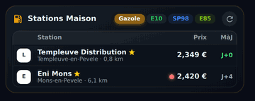

# ⛽ Carburant HOLM

[](https://hacs.xyz/)


**Où faire le plein au meilleur prix, près de chez vous, en un coup d'œil ?**

Carburant HOLM est une intégration **Home Assistant** qui suit en continu les **prix des carburants en France** autour de chez vous, ou autour de n'importe quelle ville. Elle trouve **la station la moins chère de votre zone**, suit la **tendance des prix**, garde un œil sur **vos stations favorites** et fournit **une carte Lovelace moderne**, prête à l'emploi.

> ✨ **100 % automatique, 100 % visuel, zéro YAML.**
> On l'installe, on choisit sa ville et son rayon **sur une carte**, on coche ses stations : c'est tout.
> La carte s'ajoute depuis le sélecteur de cartes et **tous ses réglages se font dans l'éditeur visuel**.

### En bref

- 🗺️ **Votre zone, dessinée sur une carte** : une ville ou un code postal, puis le point et le rayon ajustés à la souris (1 à 50 km). Autant de zones que vous voulez : Maison, Travail, Vacances…
- 📍 **Zone mobile** : la zone peut suivre une personne ou un téléphone (application compagnon) ; les stations proches sont rechargées quand elle se déplace.
- 🧩 **Plusieurs zones dans une même carte** : stations réunies, classement et meilleur prix calculés sur l'ensemble.
- 🏆 **Le moins cher, tout de suite** : la meilleure station de la zone pour chaque carburant, son prix, sa distance, son écart à la moyenne et un bouton **Itinéraire**.
- 📈 **La tendance** : historique sur 120 jours, évolution à 1 et 7 jours et courbe « meilleur prix / moyenne » dans la carte.
- ⭐ **Vos stations** : prix, rang dans la zone, écart au meilleur prix et à la moyenne, et historique pour chacune (avec sa courbe dans la fiche de la station), favorites comprises **même hors zone** : une recherche par commune ou code postal permet d'ajouter n'importe quelle station de France.
- 🧭 **Un clic, et on y va** :
  - **vue compacte** : un toucher sur une station ouvre **Google Maps en mode itinéraire** ;
  - **vue complète** : un toucher sur une station déplie **sa fiche détaillée** (adresse, prix de **tous** ses carburants, services, automate 24 h/24) avec les boutons **Google Maps** et **Waze** ;
  - réglable : itinéraire, fiche détaillée, ou **lecture seule** (aucun lien).
- 🔤 **Stations homonymes distinguées** : deux « Super U Poitiers » affichent leur adresse.
- 🏷️ **Noms, enseignes et logos automatiques**, sans rien saisir (OpenStreetMap et Wikimedia).
- 🚫 **Pas de prix périmés** : un prix trop ancien (seuil réglable) ne compte plus dans le classement, et chaque prix affiche sa fraîcheur.
- ⛔ **Ruptures signalées** : une station en rupture est clairement indiquée.
- 🔔 **Prêt pour vos automatisations** : des capteurs riches (station, distance, top 5, tendances…) pour être prévenu quand le gazole baisse ou quand la station la moins chère change.
- 🔄 **Toujours à jour** : les prix sont actualisés automatiquement (de 10 min à 24 h), avec un bouton ↻ pour forcer, et les nouvelles versions arrivent par HACS.

Données officielles : flux instantané v2 du Ministère de l'Économie ([data.economie.gouv.fr](https://data.economie.gouv.fr/explore/dataset/prix-des-carburants-en-france-flux-instantane-v2/)), mises à jour en continu par les stations.

| Carte complète | Carte compacte | Compacte · favorites |
|---|---|---|
|  |  |  |

### 🆕 Nouveautés de la 1.5.0

- 📈 **Les valeurs sur la courbe** ([#9](https://github.com/kaaribou/carburant-holm/issues/9)) : prix le plus haut et le plus bas de la période sur l'axe, meilleur prix et moyenne du jour au bout des courbes, et le détail d'un jour (date, meilleur prix, moyenne) en passant la souris ou en touchant la courbe. Option `chart_values` pour revenir à la courbe seule.
- 🏷️ **Une courbe par station** : dans la fiche dépliée d'une station, la courbe de son prix pour le carburant choisi, comparée à la moyenne de la zone, avec les mêmes valeurs. L'historique est maintenant enregistré pour toutes les stations de la zone (il se remplit à partir de la mise à jour ; celui des favorites existe déjà).

### Nouveautés de la 1.4.0

| | |
|---|---|
| ⭐ **Favorites hors zone** | Ajoutez **n'importe quelle station de France** à vos favorites : dans l'étape des favorites, tapez une commune ou un code postal, cochez les stations trouvées. Elles s'affichent avec la mention « hors zone ». |
| 🧩 **Plusieurs zones dans une carte** | Réunissez *Maison* et *Travail* (ou plus) dans la même carte : un seul classement, un seul meilleur prix. |
| 📍 **Zone mobile** | La zone suit une personne ou un téléphone : les stations proches se rechargent au fil de vos déplacements. |
| ↕️ **Tri au choix** | Prix le plus bas d'abord (favorites et hors zone mélangés), distance, mise à jour, nom… et tri d'un clic sur les en-têtes de la vue compacte. |
| 👆 **Clic sur une station** | Itinéraire, fiche détaillée, ou **lecture seule** sans aucun lien. |
| 🔤 **Stations homonymes** | Deux « Super U » dans la même ville ? Leur adresse est affichée pour les distinguer. |

---

## Sommaire

- [Pourquoi cette intégration ?](#pourquoi-cette-intégration-)
- [Installation](#installation)
- [Configuration](#configuration)
- [Modifier une zone (options)](#modifier-une-zone-options)
- [Entités créées](#entités-créées)
- [La carte `holm-fuel-card`](#la-carte-holm-fuel-card)
- [Exemples d'automatisations](#exemples-dautomatisations)
- [Exemples de templates](#exemples-de-templates)
- [API WebSocket](#api-websocket)
- [Comment sont calculés les prix ?](#comment-sont-calculés-les-prix-)
- [FAQ / dépannage](#faq--dépannage)
- [Crédits & licence](#crédits--licence)

---

## Pourquoi cette intégration ?

| Besoin | Carburant HOLM |
|---|---|
| **Installer sans prise de tête** | HACS, un redémarrage, puis un **assistant pas à pas** dans *Paramètres → Appareils et services*. **Aucune ligne de YAML.** |
| **Choisir sa zone simplement** | Tapez une **ville ou un code postal** et ajustez **le point et le rayon directement sur une carte**. Changez-les plus tard en deux clics dans *Configurer*. |
| **Choisir ses stations sans chercher d'identifiant** | L'assistant **liste toutes les stations de la zone**, triées par distance, avec leur nom, leur ville et leurs prix du moment : on coche ses favorites. |
| **Savoir où c'est le moins cher** | Un capteur **« Meilleur prix »** par carburant : station, enseigne, adresse, distance, date du prix, écart à la moyenne et **top 5**. |
| **Suivre l'évolution** | **Historique 120 jours** (meilleur prix et moyenne de la zone, prix de chaque station de la zone et de vos favorites) et **tendance à 1 et 7 jours**, visibles dans la carte et utilisables dans vos automatisations. |
| **Ne pas se faire piéger par un vieux prix** | Les prix plus anciens que *N* jours (réglable) sont **ignorés** ; chaque prix affiche sa fraîcheur (● vert, orange ou gris, ou *J+n*). |
| **Un bel affichage, sans configuration** | La carte **`holm-fuel-card`** est **fournie, servie et déclarée automatiquement** : rien à ajouter dans les ressources Lovelace. Elle se trouve dans le sélecteur de cartes sous **« HOLM Carburant »**. |
| **Tout régler à la souris** | **Éditeur visuel complet** : zone, présentation (complète ou compacte), carburant par défaut, onglets affichés, nombre de stations, courbe, favorites… |
| **Deux présentations au choix** | **Complète** : onglets par carburant, station la moins chère mise en avant, courbe, classement et fiche détaillée au toucher. **Compacte** : un tableau net (logo, station, prix, *J+n*) dont chaque ligne ouvre **l'itinéraire Google Maps**. |
| **Partir tout de suite** | **Itinéraire en un geste** : Google Maps depuis la vue compacte et la carte principale, **Google Maps ou Waze** depuis la fiche d'une station. |
| **Des stations reconnaissables** | **Noms, enseignes et logos** récupérés automatiquement et mis en cache ; à défaut, des initiales propres. |
| **Plusieurs lieux** | **Autant de zones que nécessaire**, chacune avec ses capteurs, ses favorites et sa carte. |

Carburants gérés : **Gazole, E10 (SP95-E10), SP98, SP95, E85, GPLc**.

---

## Installation

### Via HACS (recommandé)

1. HACS → menu **⋮** → **Dépôts personnalisés**.
2. Dépôt : `https://github.com/kaaribou/carburant-holm` — Type : **Intégration** → **Ajouter**.
3. Recherchez **Carburant HOLM** → **Télécharger**.
4. **Redémarrez** Home Assistant.

Les nouvelles versions apparaissent ensuite dans **Paramètres → Mises à jour**.

### Manuelle

Copiez le dossier `custom_components/carburant_holm` dans `/config/custom_components/`, puis redémarrez Home Assistant.

> La carte `holm-fuel-card` est incluse : **aucune ressource Lovelace à ajouter**, l'intégration l'enregistre elle-même (et met à jour son numéro de version à chaque mise à jour).

---

## Configuration

**Paramètres → Appareils et services → Ajouter une intégration → Carburant HOLM.**

| Étape | Ce que vous faites |
|---|---|
| 1. Zone | Donnez un **nom** (ex. *Maison*, *Travail*). Laissez **Ville** vide pour centrer sur votre domicile, tapez une **ville / un code postal**, ou choisissez une **personne / un téléphone** pour une **zone mobile**. |
| 2. Commune | Si plusieurs communes correspondent, choisissez la bonne (recherche via geo.api.gouv.fr). |
| 3. Carte | **Déplacez le point** et **ajustez le cercle** : toutes les stations dans ce rayon sont comparées (zone mobile : seulement le rayon). Choisissez les **carburants**, l'**âge maximum d'un prix** (défaut 7 jours) et la **fréquence d'actualisation** (10 min à 24 h, défaut 30 min). |
| 4. Favorites | Cochez vos stations habituelles dans la liste (nom, ville, distance et prix actuels affichés). **Station hors zone** : tapez une commune ou un code postal dans la recherche et validez, ses stations s'ajoutent à la liste (« hors zone »). |

### Zone mobile

Choisissez une **personne** (`person.*`) ou un **appareil** (`device_tracker.*`, par exemple le téléphone avec l'application compagnon) : la zone est centrée sur sa position et les stations sont rechargées dès qu'il s'est déplacé d'environ un tiers du rayon (au moins 1 km, au plus une fois toutes les 2 minutes). À la maison sans GPS, c'est la position du domicile qui est utilisée. L'historique et la courbe de tendance n'ont pas de sens pour une zone qui bouge : ils ne sont pas calculés.

Vous pouvez créer **autant de zones que vous voulez** : chaque zone est une entrée indépendante avec ses capteurs.

### Paramètres

| Paramètre | Défaut | Rôle |
|---|---|---|
| Nom de la zone | *Maison* ou nom de la commune | Nom de l'appareil et des entités (« Carburant Maison »). |
| Centre & rayon | Domicile, 10 km | Zone de comparaison (1 à 50 km). |
| Carburants suivis | Gazole, E10, SP98, E85 | Un jeu de capteurs par carburant. |
| Ignorer les prix plus vieux que | 7 jours | Un prix non mis à jour depuis plus longtemps n'entre pas dans le meilleur prix / la moyenne. |
| Actualisation | 30 min | Fréquence d'interrogation de l'API (les stations publient en général plusieurs fois par jour). |
| Stations favorites | — | Stations avec capteurs dédiés et historique, même hors de la zone. |

---

## Modifier une zone (options)

**Paramètres → Appareils et services → Carburant HOLM → Configurer** :

1. Renommer la zone et/ou taper une **nouvelle ville** pour la recentrer (laisser vide = garder le centre actuel), ou choisir une **personne / un téléphone** pour en faire une **zone mobile** (vider le champ pour revenir à une zone fixe) ;
2. Ajuster le **point / rayon** (zone mobile : le rayon), les **carburants**, l'âge max et l'actualisation ;
3. Mettre à jour les **favorites** ; pour une **station hors zone**, tapez une commune ou un code postal dans la recherche, validez, cochez les stations trouvées et validez à nouveau.

L'intégration se recharge automatiquement.

---

## Entités créées

Chaque zone crée un appareil **« Carburant *Nom* »** et, pour chaque favorite, un appareil **station** rattaché à la zone.

### Par carburant (zone)

| Entité | État | Principaux attributs |
|---|---|---|
| `sensor.carburant_<zone>_meilleur_prix_<carburant>` | Prix le plus bas de la zone (€/L) | `station`, `brand`, `address`, `city`, `distance_km`, `latitude`, `longitude`, `updated`, `average`, `max`, `stations_count`, `trend_1d`, `trend_7d`, `top` (5 moins chères), image = logo de l'enseigne |
| `sensor.carburant_<zone>_prix_moyen_<carburant>` | Prix moyen de la zone (€/L) | `stations_count`, `max` |

### Par station favorite et par carburant

| Entité | État | Principaux attributs |
|---|---|---|
| `sensor.<station>_<carburant>` | Prix à la pompe (€/L) | `station`, `brand`, `address`, `city`, `distance_km`, `updated`, `days_since_update`, `shortage` (rupture), `rank` (rang dans la zone), `stations_count`, `delta_vs_best`, `delta_vs_average` |

### Autres

| Entité | Rôle |
|---|---|
| `button.carburant_<zone>_actualiser_les_prix` | Force une actualisation immédiate. |

Toutes les valeurs de prix ont `state_class: measurement` : elles alimentent les **statistiques long terme** de Home Assistant (graphiques natifs, carte *statistics-graph*, etc.).

> Les entity_id exacts dépendent du nom de la zone et des stations ; retrouvez-les dans l'appareil de la zone.

---

## La carte `holm-fuel-card`

Ajoutez une carte → cherchez **« HOLM Carburant »**. Tout se règle dans l'éditeur visuel ; aucune entité à choisir, la carte lit directement les données de la zone.

### Vue complète

- **Onglets carburants** avec le meilleur prix de chacun ;
- **Station la moins chère** : logo, nom, ville, distance, prix, ancienneté du prix, **tendance sur 7 jours**, **écart à la moyenne**, bouton **Itinéraire** ;
- **Courbe** meilleur prix / moyenne de la zone (jusqu'à 45 jours), avec les prix extrêmes, les valeurs du jour et le détail d'un jour au survol ou au toucher ;
- **Classement** avec barre relative, écart au premier, fraîcheur du prix (● vert < 48 h, ● orange ≤ 3 j, ● gris au-delà), ruptures ;
- **Vos favorites** épinglées (★) même hors du top, y compris les stations **hors zone** ;
- **Tri au choix** (option *Tri des stations*) : classement puis favorites, ou une seule liste triée par prix, distance, mise à jour ou nom ;
- **Plusieurs zones** réunies si vous en choisissez plusieurs (classement et meilleur prix sur l'ensemble) ; une **zone mobile** affiche « autour de … » et masque la courbe ;
- **Toucher une station** : adresse, **tous ses carburants**, services (lavage, boutique, gonflage, DAB…), automate 24/24, liens **Google Maps** et **Waze** (ou itinéraire direct, ou rien : option *Clic sur une station*) ;
- Bouton **↻** d'actualisation.

### Vue compacte

Tableau façon « liste de stations » : logo · nom (ville, distance) · prix · **MàJ en J+n**, pastille ● verte sur la moins chère et ● rouge sur la plus chère, boutons carburants et **↻**. Toucher une ligne ouvre l'itinéraire (ou la fiche, ou rien : option *Clic sur une station*). Les en-têtes *Station* (distance), *Prix* et *MàJ* sont cliquables pour trier. Option *uniquement mes favorites*.

### Options

| Option | YAML | Défaut | Description |
|---|---|---|---|
| Zones | `entry_ids` | première zone | Une ou plusieurs zones ; plusieurs zones sont réunies dans la même carte (classement et meilleur prix sur l'ensemble). L'ancien `entry_id` reste accepté. |
| Tri des stations | `sort` | `default` | `default` (classement puis favorites), `price` (prix le plus bas d'abord, favorites et hors zone compris), `distance`, `updated` (mise à jour la plus récente) ou `name`. En vue compacte, un clic sur les en-têtes *Station* / *Prix* / *MàJ* trie aussi à la volée. |
| Clic sur une station | `station_click` | `details` (complète) / `maps` (compacte) | `details` (fiche détaillée), `maps` (itinéraire Google Maps) ou `none` (lecture seule, aucun lien). |
| Présentation | `layout` | `full` | `full` (complète) ou `compact`. |
| Apparence | `theme` | `auto` | `auto` (suit le mode clair / sombre de Home Assistant), `dark`, `light` ou `theme` (reprend les couleurs de votre thème). |
| Titre | `title` | « Carburant *zone* » / « Stations *zone* » | Titre personnalisé. |
| Carburant par défaut | `fuel` | premier suivi | `gazole`, `e10`, `sp98`, `sp95`, `e85`, `gplc`. |
| Onglets | `fuels` | tous | Liste des carburants proposés dans la carte. |
| Lignes | `rows` | `6` | Nombre de stations du classement. |
| Courbe | `show_chart` | `true` | Affiche la tendance (vue complète). |
| Valeurs sur la courbe | `chart_values` | `true` | Prix extrêmes, valeurs du jour et détail d'un jour au survol. `false` : courbe seule. |
| Favorites | `show_favorites` | `true` | Ajoute vos favorites hors du top. |
| Uniquement favorites | `favorites_only` | `false` | Vue compacte limitée à vos favorites. |

```yaml
# Vue complète, gazole par défaut, 8 stations
type: custom:holm-fuel-card
fuel: gazole
rows: 8

# Vue compacte limitée à mes stations, onglets E10 et SP98
type: custom:holm-fuel-card
layout: compact
favorites_only: true
fuels: [e10, sp98]
title: Mes stations

# Deux zones réunies, en lecture seule
type: custom:holm-fuel-card
entry_ids: [abc123, def456]
station_click: none
```

---

## Exemples d'automatisations

**Alerte quand le gazole passe sous un seuil**

```yaml
alias: Gazole pas cher
triggers:
  - trigger: numeric_state
    entity_id: sensor.carburant_maison_meilleur_prix_gazole
    below: 1.70
actions:
  - action: notify.mobile_app_mon_telephone
    data:
      title: "⛽ Gazole à {{ states('sensor.carburant_maison_meilleur_prix_gazole') }} €"
      message: >
        {{ state_attr('sensor.carburant_maison_meilleur_prix_gazole', 'station') }}
        ({{ state_attr('sensor.carburant_maison_meilleur_prix_gazole', 'city') }},
        {{ state_attr('sensor.carburant_maison_meilleur_prix_gazole', 'distance_km') }} km)
```

**Prévenir quand la station la moins chère change**

```yaml
alias: Nouvelle station la moins chère (E10)
triggers:
  - trigger: state
    entity_id: sensor.carburant_maison_meilleur_prix_e10
    attribute: station_id
actions:
  - action: notify.mobile_app_mon_telephone
    data:
      message: >
        Le moins cher en E10 est maintenant {{ state_attr(trigger.entity_id, 'station') }}
        à {{ states(trigger.entity_id) }} €.
```

**Hausse marquée sur 7 jours**

```yaml
alias: Hausse du SP98
triggers:
  - trigger: template
    value_template: "{{ (state_attr('sensor.carburant_maison_meilleur_prix_sp98', 'trend_7d') or 0) > 0.05 }}"
actions:
  - action: notify.mobile_app_mon_telephone
    data:
      message: "Le SP98 a pris plus de 5 centimes en une semaine : faites le plein bientôt."
```

**Rappel du vendredi : où faire le plein ?**

```yaml
alias: Plein du week-end
triggers:
  - trigger: time
    at: "17:00:00"
conditions:
  - condition: time
    weekday: [fri]
actions:
  - action: notify.mobile_app_mon_telephone
    data:
      message: >
        
        Top E10 : {{ t.name }} {{ t.price }} €{{ ', ' if not loop.last }}
```

---

## Exemples de templates

```jinja
{# Économie sur un plein de 50 L en allant à la station la moins chère plutôt qu'à ma favorite #}
{{ ((states('sensor.templeuve_distribution_e10') | float - states('sensor.carburant_maison_meilleur_prix_e10') | float) * 50) | round(2) }} €

{# Rang de ma station #}
{{ state_attr('sensor.templeuve_distribution_e10', 'rank') }} / {{ state_attr('sensor.templeuve_distribution_e10', 'stations_count') }}
```

---

## API WebSocket

La carte utilise la commande `carburant_holm/data`, disponible pour vos propres cartes / scripts :

```json
{ "type": "carburant_holm/data", "entry_id": "optionnel", "history_days": 60 }
```

Réponse : `version` et `zones[]` avec pour chaque zone `entry_id`, `title`, `zone`, `center`, `radius`, `fuels`, `favorites`, `max_age_days`, `updated`, `stations[]` (id, nom, enseigne, logo, adresse, coordonnées, distance, carburants avec prix / date / rang / rupture, services, automate 24/24), `stats` (par carburant : meilleur, moyenne, max, classement, tendances), `history` (par carburant : `date`, `min`, `avg`), `favorites_history` et `stations_history` (par station puis par carburant : `date`, `price`).

---

## Comment sont calculés les prix ?

- **Source** : API Opendatasoft du flux instantané v2 (mis à jour en continu par les stations). Requête géographique `distance(geom, POINT, rayon)` + stations favorites par identifiant.
- **Meilleur prix** : le plus bas parmi les stations **de la zone** dont le prix a moins de *N* jours ; en cas d'égalité, la plus proche l'emporte.
- **Moyenne / max** : sur les mêmes prix récents.
- **Historique** : une valeur par jour (dernier relevé du jour) conservée **120 jours** dans le stockage de Home Assistant.
- **Tendance** : différence du meilleur prix entre aujourd'hui et il y a 1 / 7 jours.
- **Noms, enseignes & logos** : le flux officiel ne les fournit pas. L'intégration les lit dans **OpenStreetMap** (stations `amenity=fuel`, reliées au flux par l'étiquette `ref:FR:prix-carburants`, sinon par proximité à moins de 150 m) et récupère le logo de l'enseigne via **Wikidata / Wikimedia Commons**. Tout est mis en cache (stations relues chaque semaine, logos chaque mois). À défaut : « *Enseigne* *ville* » ou « Station *ville* », et les initiales à la place du logo.

---

## FAQ / dépannage

| Symptôme | Solution |
|---|---|
| *« Le flux de configuration n'a pas pu être chargé »* | Redémarrez Home Assistant après l'installation ; consultez les journaux (`custom_components.carburant_holm`). |
| La courbe dit « l'historique se construit » | Normal les premiers jours : 1 point par jour. La tendance 1 j apparaît le lendemain, celle à 7 j au bout d'une semaine. |
| Une station n'a pas de nom / de logo | Elle n'est pas (ou mal) renseignée dans OpenStreetMap : ajoutez-y son nom, son enseigne (`brand`, `brand:wikidata`) et l'étiquette `ref:FR:prix-carburants` = identifiant de la station. La correction apparaît au rafraîchissement hebdomadaire. |
| Un prix semble ancien | Voir l'attribut `updated` / la colonne *MàJ* ; baissez l'âge max dans les options pour l'exclure du classement. |
| La carte de choix de la zone affiche « API KEY REQUIRED » | Problème de Home Assistant lui-même (le fournisseur de fonds de carte CARTO exige désormais une clé), corrigé dans les versions de Home Assistant publiées **après la 2026.8.3** : mettez Home Assistant à jour. |
| L'assistant tourne longtemps puis « Erreur inconnue » | Corrigé en 1.3.3 : mettez l'intégration à jour depuis HACS. |
| Texte illisible (noir sur fond sombre) avec un thème clair | Corrigé en 1.3.4 : la carte s'adapte au mode clair / sombre. Vous pouvez aussi forcer l'option **Apparence** (`theme`) sur Clair, Sombre ou « Couleurs de mon thème ». |
| La carte ne se met pas à jour après une mise à jour | Rechargez la page sans cache (Ctrl + F5) ou videz le cache du frontend dans l'application mobile. |
| Trop / pas assez de stations | Ajustez le rayon (options). Au-delà de 400 stations, seules les 400 premières sont chargées. |
| Ajouter une station située hors de la zone | Options → favorites → tapez sa commune ou son code postal dans la recherche, validez, cochez-la (1.4.0). |
| Deux stations portent le même nom | Leur adresse est affichée depuis la 1.4.0 ; avant, l'une pouvait sembler « en rupture » alors qu'il s'agissait d'une autre station. |
| La zone mobile ne bouge pas | Vérifiez que la personne / l'appareil a bien une position GPS (attributs `latitude` / `longitude`) : l'application compagnon doit avoir la localisation activée. À la maison sans GPS, c'est le domicile qui sert de centre. |
| Afficher Maison et Travail dans la même carte | Éditeur de la carte → *Zones* : cochez les deux (1.4.0). |

Journal détaillé :

```yaml
logger:
  logs:
    custom_components.carburant_holm: debug
```

---

## Un petit merci ?

Carburant HOLM vous fait économiser quelques centimes à la pompe ? Vous pouvez m'offrir une bière 🍺

[](https://paypal.me/kaaribou)

---

## Crédits & licence

- Données : **Ministère de l'Économie** — *Prix des carburants en France, flux instantané v2* — Licence Ouverte / Etalab 2.0.
- Communes : **geo.api.gouv.fr**.
- Noms et enseignes des stations : © contributeurs [OpenStreetMap](https://www.openstreetmap.org/copyright) (ODbL).
- Logos : [Wikidata](https://www.wikidata.org) / [Wikimedia Commons](https://commons.wikimedia.org) (les logos restent la propriété de leurs marques).
- Code : licence **MIT** — © kaaribou.

Voir le [CHANGELOG](CHANGELOG.md).

Fait partie de **HOLM — Home Orchestration & Living Management** : la gestion et l'orchestration intelligente de la maison.

Les autres projets : [Volets HOLM](https://github.com/kaaribou/volets-holm) · [Climat HOLM](https://github.com/kaaribou/climat-holm) · [Commandes à la maison HOLM](https://github.com/kaaribou/commandes-holm) · [HOLM My Menu](https://github.com/kaaribou/holm-mymenu) · [HOLM LaMetric](https://github.com/kaaribou/lametric-holm) · [HOLM Navbar Card](https://github.com/kaaribou/holm-navbar-card) · [HOLM Climate Card](https://github.com/kaaribou/climate-card-holm) · [HOLM Music Card](https://github.com/kaaribou/holm-music-card) · [HOLM Sentinel Card](https://github.com/kaaribou/holm-sentinel-card) · [HOLM Security Card](https://github.com/kaaribou/holm-security-card) · [HOLM Recordings Card](https://github.com/kaaribou/holm-recordings-card) · [HOLM Covers Card](https://github.com/kaaribou/holm-covers-card) · [HOLM Power Flow Card](https://github.com/kaaribou/holm-power-flow-card) · [HOLM Energy Cards](https://github.com/kaaribou/holm-energy-cards) · [HOLM Radiator Card](https://github.com/kaaribou/holm-radiator-card) · [HOLM Floor Card](https://github.com/kaaribou/holm-floor-card) · [HOLM Smoke Card](https://github.com/kaaribou/holm-smoke-card) · [HOLM BG Card](https://github.com/kaaribou/holm-bg-card).
